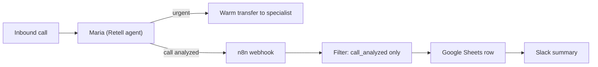

# Permit-Expediting Receptionist for a Florida Permitting Company

An inbound AI voice agent that answers calls for a permit-expediting company, spots urgent cases and transfers them to a specialist, and qualifies everyone else for a callback. Every call is logged to Google Sheets and posted to Slack. Built on Retell AI and n8n.

## What it does

- "Maria" greets the caller, answers permit questions from the knowledge base, and works out whether the case is urgent.
- **Urgent cases** (a stop-work order, a violation notice, a failed inspection, a start date 14 days away or sooner, a stressed caller, or a caller who says it's urgent): she collects only name, phone and email, then warm-transfers the call to a specialist.
- **Everyone else** gets the full qualification: project type, property location, timeline, and whether they're the owner or the contractor. Then name, phone, email and property address, read back for accuracy, and a callback within 8 hours.
- If the transfer fails, she offers the same 8-hour callback.
- After the call, n8n appends the details to Google Sheets and posts a summary to the team's Slack channel.

## How it works



## What's in this repo

```
agents/    Retell agent config
prompts/   Full agent prompt
n8n/       The n8n post-call workflow
```

## Stack

| Layer | Tool |
|---|---|
| Voice agent | Retell AI (gpt-4.1 at temperature 0, ElevenLabs voice, noise cancellation) |
| Orchestration | n8n |
| Lead log | Google Sheets |
| Alerts | Slack |

## Agent setup

- Tools: `transfer_to_specialist` (a warm transfer that gives the specialist a private summary before connecting the caller) and `end_call`.
- The agent also transfers when a caller asks for a person, or asks something the knowledge base doesn't cover.
- Post-call analysis captures 9 fields: `full_name`, `email_address`, `call_back_number`, `property_address`, `project_type`, `project_location`, `timeline`, `role` (owner or contractor) and `urgency`.

## Key design decisions

- **Urgency checked at every point.** The agent watches for urgency from the first sentence, not only at the timeline question, and switches to the urgent path the moment it hears it.
- **A hard line on the timeline.** 14 days or fewer is urgent, 15 days or more is not. The prompt lists examples on both sides so "two weeks" and "three weeks" land on the right side.
- **Urgent callers answer three questions, not eight.** Name, phone and email are enough for the specialist to act, so the agent skips the address and the rest of the qualification.
- **The specialist hears the case first.** The warm transfer passes a private summary, so the caller doesn't repeat themselves.
- **No pricing on the call.** Pricing depends on the project, so the agent always leaves it to the specialist.
- **One row and one message per call.** The n8n filter passes only the `call_analyzed` event, so each call writes one complete row and posts one Slack summary.

## Placeholders

| Placeholder | Replace with |
|---|---|
| `your-n8n-instance.example.com` | Your n8n base URL |
| `YOUR_WEBHOOK_PATH` | The webhook paths you choose |
| `YOUR_GOOGLE_SHEET_ID` | Your Google Sheet ID |
| `YOUR_SHEET_TAB` | Your sheet tab |
| `YOUR_SLACK_CHANNEL_ID` | Your team's Slack channel |
| `+12125550104` | Your specialist's transfer number |

## License

All rights reserved. Published for viewing only. See [LICENSE](LICENSE).
